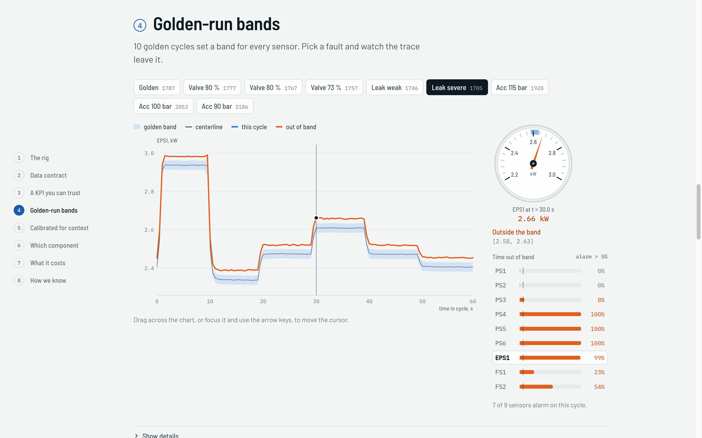
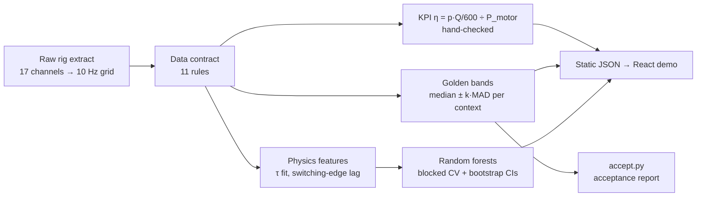

<div align="center">

# Hydraulic Centerline Lens

**How many golden runs does a centerline need before its alarms can be trusted? Measured on 2,205 real cycles of a hydraulic test rig.**

[](pipeline/tests)
[](LICENSE)
[](https://doi.org/10.24432/C5CW21)
[](pipeline/requirements.txt)
[](package.json)

**[Live demo](https://ibiraheel.com/demos/hydraulic-centerline-lens/)** · [METHOD.md](METHOD.md) · [SOLUTION.md](SOLUTION.md)



</div>

---

## The question

When a new production line goes live on a data platform, how many golden runs does a centerline need before its alarms can be trusted? And how do you prove the KPIs and cleansing rules are right before anyone acts on them?

## The answer

One golden set copied across operating conditions false-alarmed on **21 of 30** healthy cycles. One band per condition, built from about **9 golden cycles each**, got that to **0 of 30** and still caught all 60 leakage cycles. On injected data defects, four physics checks added to the range checks lifted the catch rate from **20 % to 96 %**.

## The solution

A five-step acceptance recipe ([SOLUTION.md](SOLUTION.md)) and a small tool, `pipeline/accept.py`. Give it a line's extract and the cycles you call golden. It runs 11 data-contract rules, tells you how many more golden cycles each operating context needs, and labels every cycle **fix the data**, **in band** or **out of band**, with a hint at the component behind it.

---

## Key results

Every number comes from `public/data/summary.json` and `public/data/extended.json`, written by the pipeline on the full dataset. Equations and caveats are in [METHOD.md](METHOD.md).

| Measure | Result |
| --- | --- |
| False alarms, one golden set for every context | 21 / 30 healthy cycles (70 %, 95 % CI 52–83 %) |
| False alarms, one band per context (k = 3, f = 20 %) | 0 / 30 (95 % upper bound 11.4 %) |
| Golden cycles per context vs false-alarm rate | 5 → 24 % · 7 → 2.9 % · 9 → 0 of 900 held-out resamples |
| Leakage caught by the calibrated band | 30 / 30 at both the weak and severe level |
| Injected data defects caught | 20 % with 7 range rules → 95.7 % with all 11 rules |
| Efficiency KPI η vs the rig's own efficiency channel | r = 0.9991, hand-checked at one instant (2.171 kW) |
| Cost of weak pump leakage, matched over 48 cells | −3.2 efficiency points (CI −3.35 to −3.02), +3.9 % motor energy |
| Accumulator accuracy, shuffled vs blocked CV | 98.8 % vs 77.4 %: shuffled splits overstate it by 21 points |

## AI vs baseline

One random forest per component, scored on blocked cross-validation (contiguous 50-cycle blocks) with block-bootstrap 95 % CIs. "With physics" adds 11 measured features: the accumulator's step-response time constant τ and the valve's switching-edge lag.

| Task | Simple baseline | Model | Verdict |
| --- | --- | --- | --- |
| Cooler state | majority class 33.6 % | forest 99.4 % (98.6–100) | Win |
| Valve state | majority class 51.0 % | forest 91.1 % → 99.6 % with physics (98.8–100) | Win |
| Pump leakage | majority class 55.4 % | forest 96.5 % (92.0–99.5) | Win |
| Accumulator pre-charge | majority class 36.6 % | forest 77.4 % → 89.5 % with physics (83.3–95.2) | Win, but the weakest model; it stays in shadow mode |
| Valve degradation | calibrated golden band flags 33–47 % of valve-fault cycles | forest with edge lag classifies valve state at 99.6 % | Win for the model |
| Weak leakage | calibrated golden band flags 30 / 30 stable cycles | forest recall 91.3 % (n = 492, all cycles) | Loss for the model. The samples differ, so read it as "the band is enough here" |

Two caveats. On accumulator, a forest on the 11 physics features alone (91.8 %, 86.8–96.1) scores at least as well as one on all 133 features, so the summary statistics add nothing there. And the 89.5 % holds at 50-cycle blocks only; at 100- and 200-cycle blocks it falls well below that.

## How it works



The pipeline (`numpy`, `pandas`, `scipy`, `scikit-learn`) runs offline and writes static JSON. The demo reads only that JSON, so it needs no server and no API keys.

## Quickstart

**1. Get the data.** Download *Condition monitoring of hydraulic systems* from the [UCI ML Repository](https://archive.ics.uci.edu/dataset/447/condition+monitoring+of+hydraulic+systems) and unzip it so the `.txt` files sit in `downloads/raw/`.

**2. Run the pipeline and the tests.**

```bash
uv venv .venv && uv pip install --python .venv/bin/python -r pipeline/requirements.txt

OMP_NUM_THREADS=2 .venv/bin/python -I pipeline/run.py downloads/raw public/data            # ~20 s
OMP_NUM_THREADS=2 .venv/bin/python -I pipeline/run_extended.py downloads/raw public/data   # ~2.5 min
.venv/bin/python -m pytest -q pipeline/tests                                               # 36 tests
```

**3. Run the acceptance tool.** This marks the 30 healthy steady-state cycles as golden and checks every cycle against them (about 10 s).

```bash
awk -F'\t' '$2==100 && $3==0 && $4==130 && $5==0 {print NR-1}' downloads/raw/profile.txt > golden.txt
.venv/bin/python -I pipeline/accept.py downloads/raw --golden golden.txt --context cooler \
    --k 3 --f 0.2 --out report.json --cache pipeline/cache
```

**4. Run the demo.**

```bash
npm install
npm run dev      # http://localhost:5173/demos/hydraulic-centerline-lens/
npm run build    # static site in dist/, built for the /demos/hydraulic-centerline-lens/ path
```

## Repository layout

```
pipeline/
  hcl/             loader, resampling, contract rules, KPIs, envelopes, calibration,
                   physics features, models, statistics, value, mutation test
  run.py           core pipeline -> summary.json, envelope.json, kpi_points.json
  run_extended.py  calibration, physics, CIs, value, mutations -> extended.json
  accept.py        the acceptance tool (see SOLUTION.md)
  tests/           36 pytest tests: hand calculations, synthetic recoveries, output checks
src/               Vite + React demo, a 9-step guided walk through the results
public/data/       precomputed results the demo reads
METHOD.md          equations, assumptions, validation, full results
SOLUTION.md        the acceptance recipe, decision thresholds and a week-1 plan
```

## Limitations

- The calibrated band rests on 10 healthy cycles per context. 0 of 30 false alarms bounds the rate only below 11.4 %; a 5 % claim needs about 60 alarm-free cycles per context.
- k and f were chosen on the same 30 healthy cycles they are scored on, so expect a somewhat higher false-alarm rate on new data. The 900 held-out tests are resamples of those cycles, not independent tests.
- The four physics contract rules were written after seeing which injected defects slipped through. They work on this data, but the mutation test is not an independent check of them.
- The rig steps through its fault grid in order, so condition is confounded with time and oil temperature. Accumulator accuracy depends strongly on the validation block size.
- The dataset holds fixed leakage levels, not a progression over time, so any lead time on a real line is inferred, not measured.

## Data

Real measurements from N. Helwig, E. Pignanelli and A. Schütze, *Condition monitoring of hydraulic systems* (2015), UCI ML Repository, [doi:10.24432/C5CW21](https://doi.org/10.24432/C5CW21), licensed **CC BY 4.0**. The full set is used: 2,205 cycles × 17 channels. Synthetic data appears only in unit tests and in the labelled contract mutation test, where corruptions are injected into real cycles. No synthetic data enters the measured results.

Code is MIT-licensed ([LICENSE](LICENSE)).

## Author

**Ibi Raheel** · mechanical engineer building AI tools · [ibiraheel.com](https://ibiraheel.com)
